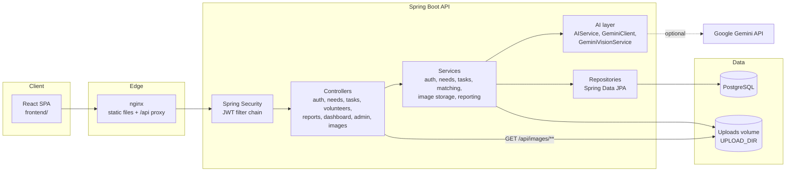
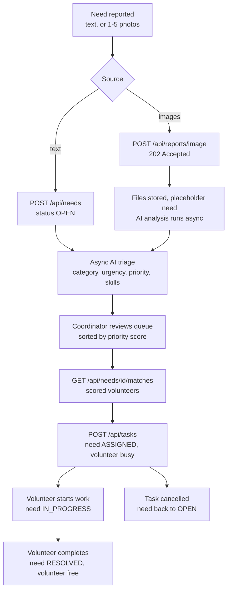
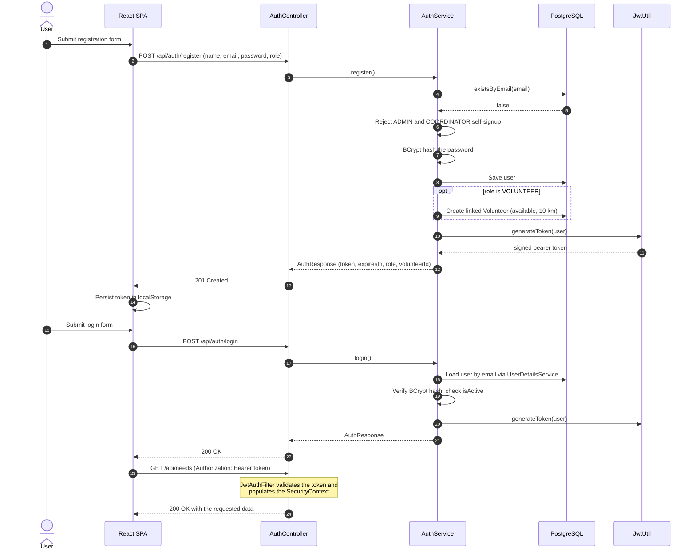
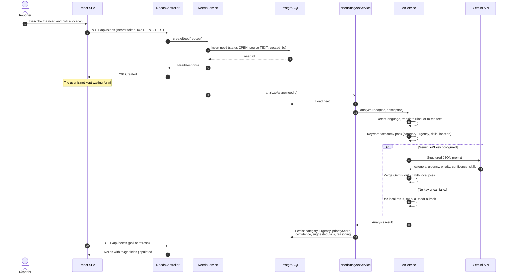
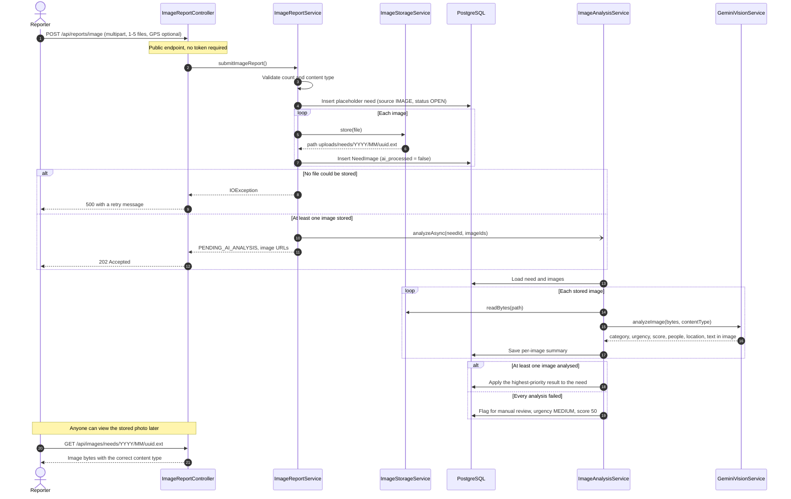
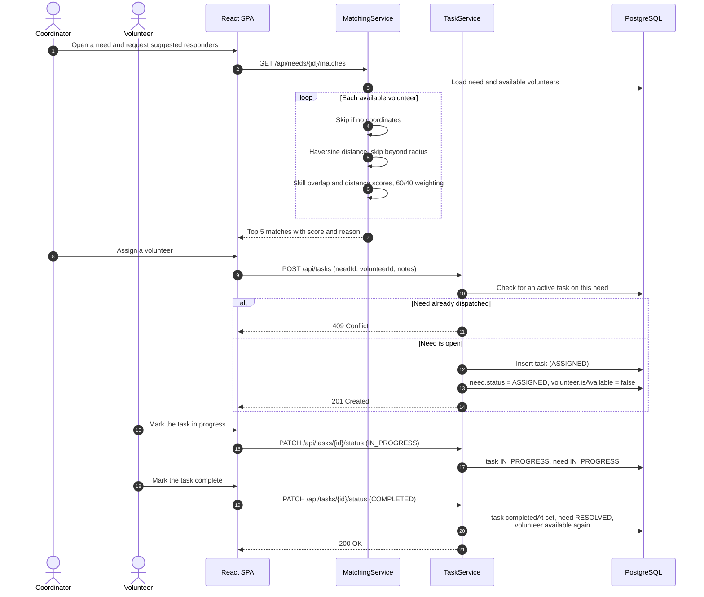
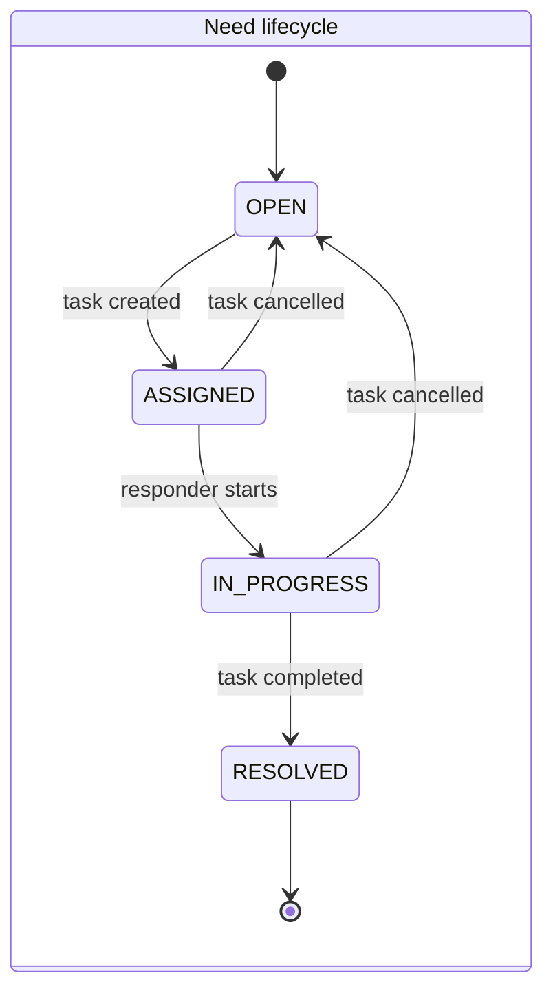
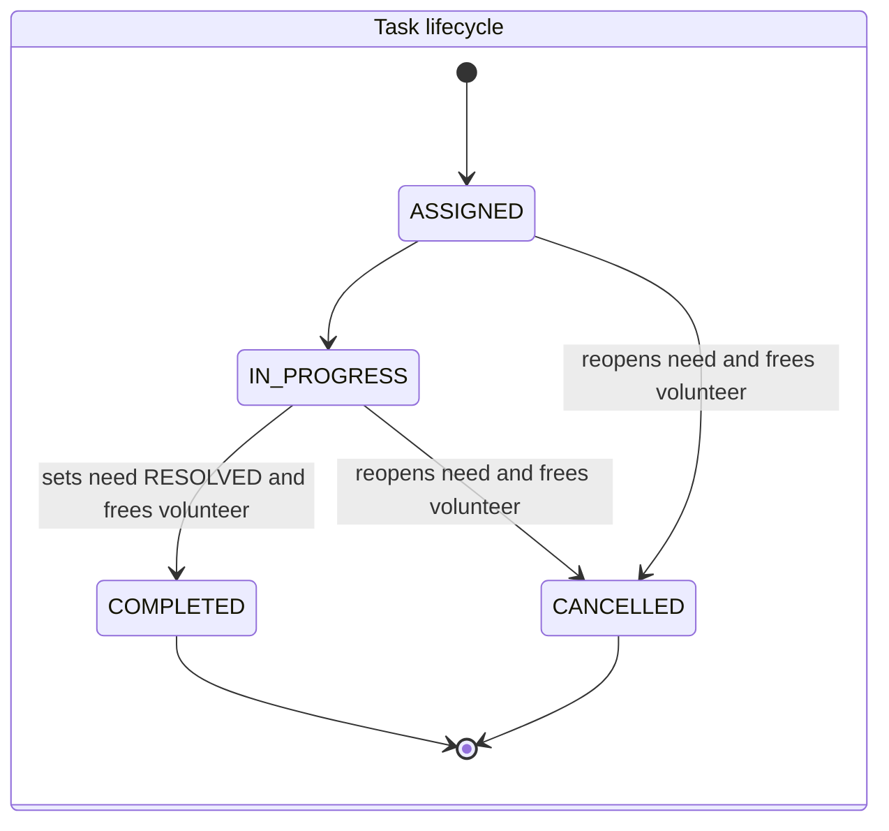
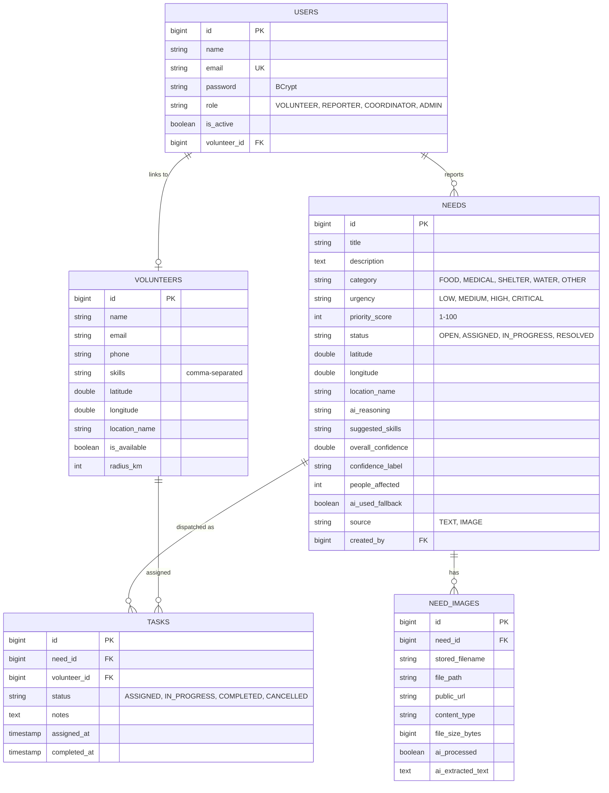
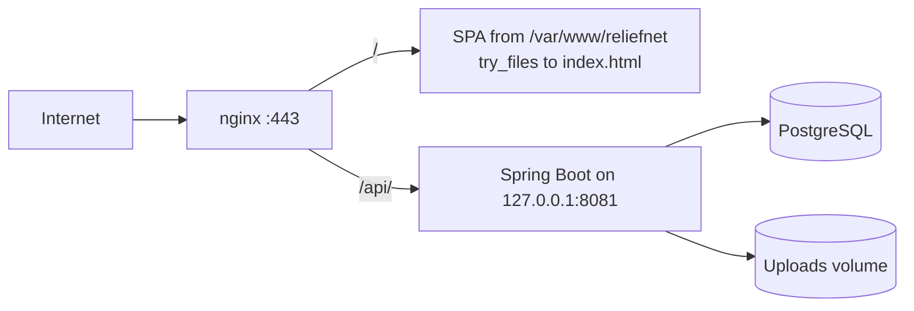

# ReliefNet

ReliefNet is a disaster relief coordination platform. Reporters file community needs
with location and photos, an AI pass classifies urgency and required skills, coordinators
match and dispatch volunteers, and volunteers carry the task through to resolution.

Two applications in one repository:

| Path | Stack | Role |
| --- | --- | --- |
| `.` (root) | Java 17, Spring Boot, Spring Security, JPA, PostgreSQL | REST API, auth, matching, AI triage |
| `frontend/` | React 19, TypeScript, Vite, Leaflet | Web client for every role |

---

## Contents

- [Architecture](#architecture)
- [Roles](#roles)
- [System flow](#system-flow)
- [Sequence diagrams](#sequence-diagrams)
- [State machines](#state-machines)
- [Data model](#data-model)
- [API reference](#api-reference)
- [Configuration](#configuration)
- [Running locally](#running-locally)
- [Frontend API URL](#frontend-api-url)
- [Docker and deployment](#docker-and-deployment)
- [Security model](#security-model)

---

## Architecture



The API is stateless: every authenticated request carries a bearer token, and no
server-side session is created (`SessionCreationPolicy.STATELESS`).

## Roles

| Role | Created by | Can do |
| --- | --- | --- |
| `REPORTER` | Self-registration | File needs, list only their own submissions |
| `VOLUNTEER` | Self-registration | View needs and the map, see assigned tasks, update task status, toggle availability |
| `COORDINATOR` | Self-registration with invite code, or an admin | Everything a reporter/volunteer can, plus dispatch: match volunteers, assign tasks, review image reports, change need status |
| `ADMIN` | Admin only | User management, role changes, deletion of needs and volunteers, full dashboard |

Self-registration cannot create `COORDINATOR` or `ADMIN` accounts directly. A volunteer
account automatically gets a linked `Volunteer` profile (available, 10 km radius) so it
can be dispatched immediately.

---

## System flow

The end-to-end lifecycle of a single incident:



Three design decisions worth noting:

- **Analysis is asynchronous.** The reporting endpoints respond immediately; triage runs
  on a separate thread and writes the result back. A failed or unconfigured AI call never
  fails the report.
- **AI is advisory, not authoritative.** Every AI field has a deterministic fallback
  (keyword taxonomy for text, manual-review flag for images), so the system works with no
  API key.
- **Dispatch is exclusive.** A need can have at most one active task; assigning a second
  responder is rejected with `409 Conflict`.

## Sequence diagrams

### 1. Registration and login



Coordinator registration differs in one step: `POST /api/auth/register/coordinator`
compares the submitted invite code against `COORDINATOR_INVITE_CODE` before creating the
account, returning `400` for a wrong code and `409`/`400` for a duplicate email.

### 2. Text need report with AI triage



### 3. Image report with vision analysis



### 4. Dispatch and completion



Matching score: `0.6 × skillScore + 0.4 × distanceScore`, where `distanceScore` is 100 at
0 km and 0 at the edge of the volunteer's radius (default 20 km). Volunteers with no
coordinates are excluded; a need without coordinates treats every in-range volunteer as
fully distance-scored.

## State machines





Cancelling a task is the only way a dispatched need returns to `OPEN`; a need cannot be
in two active tasks at once.

## Data model



AI enrichment lists (`matched_keywords`, `alternate_categories`, `ai_warnings`,
`visual_cues`) are stored in separate collection tables keyed by `need_id`.

## API reference

All routes are prefixed with `/api`. Protected routes expect
`Authorization: Bearer <token>`; unauthorized requests receive `401` with a JSON body,
insufficient roles receive `403`.

### Authentication — `/api/auth` (public)

| Method | Path | Purpose |
| --- | --- | --- |
| `POST` | `/register` | Self-register as `VOLUNTEER` or `REPORTER` |
| `POST` | `/register/coordinator` | Coordinator registration with invite code |
| `POST` | `/login` | Returns token, expiry, role, `volunteerId` |
| `GET` | `/me` | Current user profile |
| `POST` | `/change-password` | Change own password (authenticated) |

### Needs — `/api/needs`

| Method | Path | Access |
| --- | --- | --- |
| `POST` | `/` | Reporter, coordinator, admin |
| `GET` | `/` | Any authenticated role, filters `status`, `category`, `urgency`, `keyword` |
| `GET` | `/my` | Reporter, own submissions only |
| `GET` | `/map` | Volunteer, coordinator, admin (coordinate-bearing needs only) |
| `GET` | `/{id}` | Any authenticated role |
| `POST` | `/{id}/analyze` | Coordinator, admin (synchronous re-triage) |
| `PATCH` | `/{id}/status` | Coordinator, admin |
| `GET` | `/{id}/matches` | Coordinator, admin |
| `DELETE` | `/{id}` | Admin |

### Reports and images

| Method | Path | Access |
| --- | --- | --- |
| `POST` | `/reports/image` | Public, multipart `images` (1–5), optional GPS and reporter fields, returns `202` |
| `GET` | `/needs/{id}/images` | Authenticated |
| `POST` | `/needs/{id}/reanalyze` | Coordinator, admin |
| `GET` | `/images/**` | Public, serves files from `UPLOAD_DIR` |

### Tasks — `/api/tasks`

| Method | Path | Access |
| --- | --- | --- |
| `POST` | `/` | Coordinator, admin |
| `GET` | `/` | Coordinator, admin, filter `status` |
| `PATCH` | `/{id}/status` | Volunteer, coordinator, admin |
| `GET` | `/by-need/{needId}` | Coordinator, admin |
| `GET` | `/by-volunteer/{volunteerId}` | Volunteer, coordinator, admin |

### Volunteers, dashboard and admin

| Method | Path | Access |
| --- | --- | --- |
| `GET` | `/volunteers` | Coordinator, admin, `availableOnly` filter |
| `POST` | `/volunteers` | Coordinator, admin |
| `GET` | `/volunteers/{id}` | Authenticated |
| `PUT` | `/volunteers/{id}` | Authenticated |
| `PATCH` | `/volunteers/{id}/availability` | Authenticated |
| `DELETE` | `/volunteers/{id}` | Admin |
| `GET` | `/dashboard/stats` | Public, aggregate counters only |
| `GET` | `/dashboard/**` | Coordinator, admin |
| `*` | `/admin/**` | Admin only |

## Configuration

Backend values come from environment variables (or a `.env` file loaded from the working
directory). Copy `.env.example` to `.env` and fill it in; never commit the result.

| Variable | Default | Notes |
| --- | --- | --- |
| `PORT` | `8081` | HTTP port |
| `DB_URL` | `jdbc:postgresql://localhost:5432/resource_allocation` | Append `?sslmode=require` for managed databases |
| `DB_USERNAME` | `postgres` | |
| `DB_PASSWORD` | `postgres` | Required in compose |
| `JWT_SECRET` | dev placeholder | 32+ characters; required in compose |
| `JWT_EXPIRATION` | `3000000000` in code | Milliseconds. Set `3600000` for one hour |
| `COORDINATOR_INVITE_CODE` | `CODE_FOR_COORD` | Required in compose. Blank disables coordinator self-registration |
| `CORS_ALLOWED_ORIGINS` | localhost + `*.vercel.app` | Comma-separated; setting it replaces the defaults |
| `GEMINI_API_KEY` | unset | Optional. Blank keeps the keyword fallback |
| `GEMINI_API_URL` | Google endpoint | |
| `GEMINI_MODEL` | `gemini-3.5-flash-lite` | |
| `UPLOAD_DIR` | `./uploads/needs` | Persistent volume in Docker |

Profiles: no profile means production-like behaviour (quiet logging, no seed data).
`SPRING_PROFILES_ACTIVE=dev` enables SQL logging and the demo seed; never enable it on a
deployed instance.

## Running locally

### Backend

```bash
cp .env.example .env          # fill in DB_*, JWT_SECRET, COORDINATOR_INVITE_CODE
mvn spring-boot:run           # http://localhost:8081
```

Or with the database in Docker:

```bash
docker compose up -d --build  # API on 127.0.0.1:8081, PostgreSQL 16 alongside
```

Demo accounts when running with the `dev` profile:

| Email | Password | Role |
| --- | --- | --- |
| `coord@reliefnet.dev` | `Demo1234!` | Coordinator |
| `vol@reliefnet.dev` | `Demo1234!` | Volunteer |
| `rep@reliefnet.dev` | `Demo1234!` | Reporter |

### Frontend

```bash
cd frontend
npm install
npm run dev      # http://localhost:5173
npm run build    # production bundle in frontend/dist
```

## Frontend API URL

The API base URL is resolved at runtime by `frontend/src/services/api.ts`, in order:

1. `frontend/public/config.js` → `window.__RELIEFNET_CONFIG__.apiUrl`
2. the build-time `VITE_API_URL` variable
3. `http://localhost:8081`

`config.js` is copied into `dist/` and read before the bundle executes, so a deployment
can be repointed at a different backend by editing one file — no rebuild:

```js
window.__RELIEFNET_CONFIG__ = {
  apiUrl: 'https://api.example.org',
};
```

Leave `apiUrl` empty when the SPA and API share an origin behind a reverse proxy (nginx
serving `/` and proxying `/api/`). A build-time default is available when that suits the
pipeline better:

```bash
VITE_API_URL=https://api.example.org npm run build
```

Requests are JSON over `fetch`, with the token attached as a bearer header. A `401` on an
authenticated call clears the stored session and raises the global "session expired"
event; a rejected login does not disturb an existing session.

## Docker and deployment

```bash
docker compose up -d --build
```

The compose stack runs PostgreSQL 16 and the API, with named volumes `db-data` and
`uploads` so records and images survive redeploys. The API is published on
`127.0.0.1:${BACKEND_PORT:-8081}` — loopback only, so the reverse proxy is the public
entry point. `DB_PASSWORD`, `JWT_SECRET` and `COORDINATOR_INVITE_CODE` are required and
fail fast when missing.

Single-host layout:



nginx needs `client_max_body_size 32m` for photo uploads and must serve `config.js` with
`Cache-Control: no-store` so URL changes take effect immediately. HTTPS is required for
the browser geolocation button; issue certificates with certbot.

The backend image excludes `frontend/` (see `.dockerignore`); the SPA is built separately
and served as static files.

## Security model

- Passwords are BCrypt-hashed (strength 12) and never returned by any endpoint.
- Tokens are stateless JWTs; the API creates no sessions, so scaling out needs no shared
  session store. Set a short `JWT_EXPIRATION` in production.
- Authorization is deny-by-default: the filter chain lists explicit public paths
  (auth, image files, aggregate dashboard counters) and requires a valid token for
  everything else, with per-route role rules and method-level checks on admin routes.
- `/api/dashboard/stats` is public by design and exposes aggregate counters only, no
  records or personal data.
- Uploaded files are served from a directory outside the classpath; paths are resolved
  and normalised before use.
- Secrets are read from the environment. `.env` is git-ignored, and the Docker build
  context excludes it.
